<picture><source media="(prefers-color-scheme: dark)" srcset="assets/hero-dark.svg"></picture>

<a href="https://guns.lol/antoo2471"><picture><source media="(prefers-color-scheme: dark)" srcset="assets/social-1-dark.svg"></picture></a>&nbsp;<a href="https://discord.com/users/669936721730863105"><picture><source media="(prefers-color-scheme: dark)" srcset="assets/social-2-dark.svg"></picture></a>&nbsp;<a href="https://antoo.devs.li/"><picture><source media="(prefers-color-scheme: dark)" srcset="assets/social-3-dark.svg"></picture></a>

<picture><source media="(prefers-color-scheme: dark)" srcset="assets/about-dark.svg"></picture>

<picture><source media="(prefers-color-scheme: dark)" srcset="assets/stack-dark.svg"></picture>

<picture><source media="(prefers-color-scheme: dark)" srcset="assets/stats-dark.svg"></picture>

<picture><source media="(prefers-color-scheme: dark)" srcset="assets/streak-dark.svg"></picture>

<picture><source media="(prefers-color-scheme: dark)" srcset="assets/wave-dark.svg"></picture>

<a href="https://github.com/antoo2471/arkyn-launcher"><picture><source media="(prefers-color-scheme: dark)" srcset="assets/project-arkyn-launcher-dark.svg"></picture></a>&nbsp;<a href="https://github.com/antoo2471/anti-backdoor"><picture><source media="(prefers-color-scheme: dark)" srcset="assets/project-anti-backdoor-dark.svg"></picture></a>

<a href="https://github.com/antoo2471/enderpanel"><picture><source media="(prefers-color-scheme: dark)" srcset="assets/project-enderpanel-dark.svg"></picture></a>&nbsp;<a href="https://github.com/antoo2471/Navora"><picture><source media="(prefers-color-scheme: dark)" srcset="assets/project-navora-dark.svg"></picture></a>

<a href="https://github.com/antoo2471/SSGui"><picture><source media="(prefers-color-scheme: dark)" srcset="assets/project-ssgui-dark.svg"></picture></a>

<a href="https://github.com/antoo2471?tab=repositories"><picture><source media="(prefers-color-scheme: dark)" srcset="assets/button-1-dark.svg"></picture></a>&nbsp;&nbsp;<a href="https://antoo.devs.li/"><picture><source media="(prefers-color-scheme: dark)" srcset="assets/button-2-dark.svg"></picture></a>

<a href="https://metawka.github.io/expressive-profile/?from=antoo2471"><picture><source media="(prefers-color-scheme: dark)" srcset="assets/credit-dark.svg"></picture></a>

